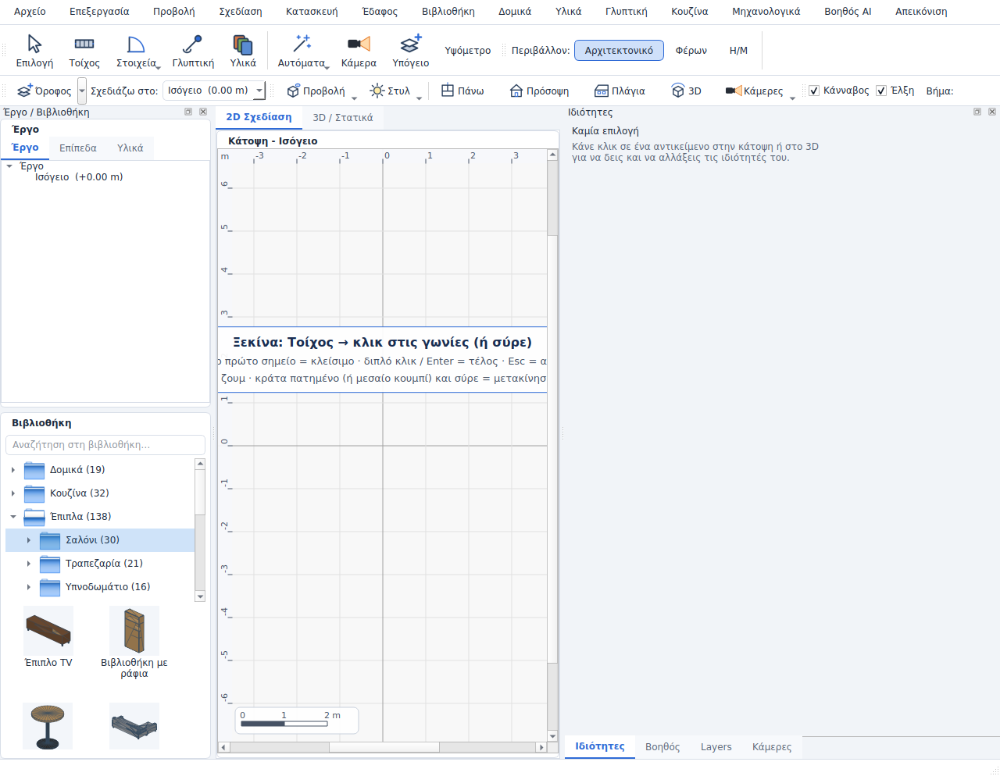
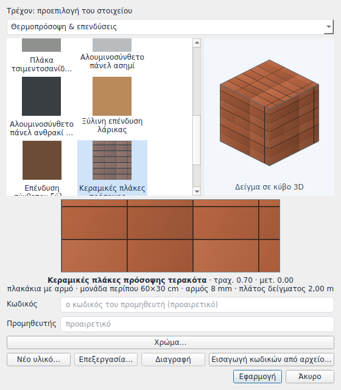

# Library, Components, materials and Transform

Based on the tested desktop branch `gpt/fix-empty-frame-storey` at `20dc9b2`.
This is an isolated feature branch; the UX report's stairs/pergola work is outside this change.

- Library categories retain search and placement/drag behavior, with actual mesh thumbnails and a category thumbnail browser.
- Right click: Properties opens the object editor for library objects and cabinets; Components focuses its part list. Transform provides numeric position, horizontal rotation and supported uniform scaling, plus the existing mouse tools. Delete remains a primary menu choice.
- Materials: select the object's component/surface, choose an icon swatch and inspect it on a textured 3D sample cube. Colour creates a project-local variant retaining the selected texture.
- Materials > Sample material: click a source surface, then click target surfaces repeatedly. The source is read from the Document and its derived unselected material, including imported palette colours. Whole-object painting is an explicit menu option. Esc exits. Every paint is one undo; sampling changes no project state.
- 3D painting resolves the clicked surface/part. The 2D plan resolves wall sides from the click position; other plan objects use their whole-object finish because individual 3D surfaces cannot be identified from a plan footprint.
- User-defined materials travel inside the project. Rendering and object previews resolve those definitions from the Document.

## Visual evidence

These are grabs of the real Qt widgets, not design mockups:

The WebGL input route is covered by code/command and derived-scene regression checks; it still needs live owner validation on the desktop before merging. Local tests use Qt offscreen. No construction or engineering verification is claimed.
