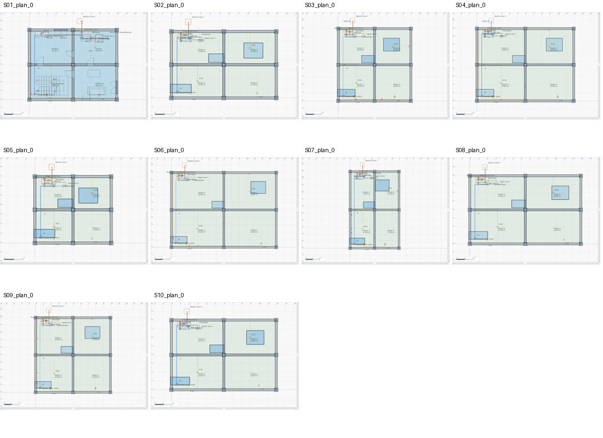

# Σχέδια για έλεγχο — επιφάνειες και υλικά

18/10/2026: χωρίς προσφορά/τιμές. Τα σχέδια παραδίδονται για διαδοχικό ανθρώπινο έλεγχο, όχι ως όλα εγκεκριμένα. Οι προειδοποιήσεις παραμένουν ορατές.

| Σχέδιο | Χώροι | Δάπεδα χώρων m² | Ενότητες εργασιών | Γραμμές υλικών | Προειδοποιήσεις |
| --- | --- | --- | --- | --- | --- |
| S01 | 8 | 145.92 | 15 | 72 | 6 |
| S02 | 9 | 158.16 | 12 | 52 | 9 |
| S03 | 12 | 221.88 | 12 | 51 | 6 |
| S04 | 8 | 199.52 | 12 | 52 | 9 |
| S05 | 13 | 168.72 | 12 | 51 | 7 |
| S06 | 8 | 261.12 | 12 | 51 | 12 |
| S07 | 12 | 209.88 | 12 | 52 | 8 |
| S08 | 9 | 213.56 | 12 | 51 | 12 |
| S09 | 8 | 184.32 | 12 | 51 | 10 |
| S10 | 13 | 286.52 | 12 | 52 | 10 |

- S01: [S01_strip_comparison.archforge](../../../docs/scenarios/foundation_review/S01_strip_comparison.archforge) · [S01_SURFACES_MATERIALS.md](S01_SURFACES_MATERIALS.md)
- S02: [S02_split_level_hillside_house.archforge](../../../tests/residential_scenarios/S02_split_level_hillside_house.archforge) · [S02_SURFACES_MATERIALS.md](S02_SURFACES_MATERIALS.md)
- S03: [S03_three_storey_urban_residence.archforge](../../../tests/residential_scenarios/S03_three_storey_urban_residence.archforge) · [S03_SURFACES_MATERIALS.md](S03_SURFACES_MATERIALS.md)
- S04: [S04_lakeside_family_villa.archforge](../../../tests/residential_scenarios/S04_lakeside_family_villa.archforge) · [S04_SURFACES_MATERIALS.md](S04_SURFACES_MATERIALS.md)
- S05: [S05_compact_stepped_townhouse.archforge](../../../tests/residential_scenarios/S05_compact_stepped_townhouse.archforge) · [S05_SURFACES_MATERIALS.md](S05_SURFACES_MATERIALS.md)
- S06: [S06_wide_mediterranean_villa.archforge](../../../tests/residential_scenarios/S06_wide_mediterranean_villa.archforge) · [S06_SURFACES_MATERIALS.md](S06_SURFACES_MATERIALS.md)
- S07: [S07_narrow_three_level_house.archforge](../../../tests/residential_scenarios/S07_narrow_three_level_house.archforge) · [S07_SURFACES_MATERIALS.md](S07_SURFACES_MATERIALS.md)
- S08: [S08_terraced_slope_residence.archforge](../../../tests/residential_scenarios/S08_terraced_slope_residence.archforge) · [S08_SURFACES_MATERIALS.md](S08_SURFACES_MATERIALS.md)
- S09: [S09_courtyard_roof_variety_house.archforge](../../../tests/residential_scenarios/S09_courtyard_roof_variety_house.archforge) · [S09_SURFACES_MATERIALS.md](S09_SURFACES_MATERIALS.md)
- S10: [S10_full_system_family_residence.archforge](../../../tests/residential_scenarios/S10_full_system_family_residence.archforge) · [S10_SURFACES_MATERIALS.md](S10_SURFACES_MATERIALS.md)

## Κάτοψεις για αρχική επισκόπηση

Οι πλήρεις λήψεις ανά επίπεδο βρίσκονται στον φάκελο `plans/`. Δεν αντικαθιστούν τον έλεγχο του αρχείου από τον ιδιοκτήτη.
